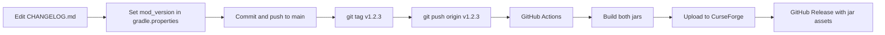

# Minecraft mod template — Forge 1.20.1 + NeoForge 1.21.1

Single repository with shared code, per-loader entry points, and a shared `libs/` folder for optional local JARs.

## Use this template

On GitHub: **Use this template** → create a new repository → clone it, then:

1. Replace `mod_id`, `mod_name`, `mod_group_id`, and packages under `com.example.examplemod`.
2. Set `curseforge_project_id` when you are ready to publish (optional until first release).
3. Run `./gradlew buildAll` to verify both loaders.

## Patch an existing mod repo

Copy in (merge carefully):

| From template | Into your repo |
|---------------|----------------|
| `common/`, `forge/`, `neoforge/` layout | Same paths, or align your sources into this structure |
| `settings.gradle`, root `build.gradle`, `gradle.properties` | Root Gradle multi-project setup |
| `gradle/curseforge-publish.gradle`, `gradle/wrapper/` | Shared publish + wrapper |
| `.github/workflows/curseforge-release.yml` | Tag-based CurseForge CI |
| `.github/copilot-instructions.md`, `.github/instructions/` | Release checks for Copilot |
| `scripts/verify-release-ready.sh`, `scripts/release-tag.sh` | Local release pre-flight |

Keep your existing `src` by moving loader code into `forge/` and `neoforge/` and shared logic into `common/`.

## Layout

| Path | Role |
|------|------|
| `common/` | Shared Java (no Minecraft / loader APIs) |
| `forge/` | Forge **1.20.1** (ModDevGradle Legacy) |
| `neoforge/` | NeoForge **1.21.1** (ModDevGradle) |
| `libs/` | Optional mod libraries (both subprojects use `flatDir`) |

Edit mod metadata once in the root `gradle.properties` (`mod_id`, `mod_name`, `mod_version`, `mod_group_id`, …). Version-specific loader settings live in `forge/gradle.properties` and `neoforge/gradle.properties`.

## Requirements

- **JDK 21** to run Gradle (toolchains compile Forge code with 17 and NeoForge with 21).
- Internet on first run (Minecraft + loader downloads).

## Commands

From the repository root:

```bash
./gradlew buildAll
./gradlew :forge:runClient
./gradlew :neoforge:runClient
```

Windows:

```bat
gradlew.bat buildAll
gradlew.bat :forge:runClient
gradlew.bat :neoforge:runClient
```

JARs:

- `forge/build/libs/` — use the **reobfuscated** jar for 1.20.1 release builds.
- `neoforge/build/libs/`

## Local libraries

Drop JARs into `libs/` and declare them in the matching `build.gradle`:

- **Forge:** `modImplementation "blank:yourmod-1.20.1"` (see [ModDevGradle Legacy](https://github.com/neoforged/ModDevGradle/blob/main/LEGACY.md))
- **NeoForge:** `localRuntime` / `implementation` as appropriate for your dependency

Use separate JARs per Minecraft version when APIs differ.

## Customization

1. Rename packages under `com.example.examplemod` to match `mod_group_id`.
2. Put cross-version logic in `common/`; register blocks, items, and events in `forge/` and `neoforge/`.
3. Bump `forge_version` / `neo_version` in the subproject `gradle.properties` when updating loaders.

## Tag-based release → CurseForge

Releases are driven by **Git tags**, not a long-lived branch. The tag name and `mod_version` must agree.

### One-time setup

1. Create the mod on [CurseForge](https://www.curseforge.com/) and copy the **Project ID** (About tab).
2. Create an API token at [CurseForge Console](https://console.curseforge.com/) → API tokens.
3. In GitHub: **Settings → Secrets and variables → Actions** → add `CURSEFORGE_API_TOKEN`.
4. Set `curseforge_project_id=<your id>` in root `gradle.properties`.

### Release workflow (you do this each version)



1. Update **`CHANGELOG.md`** (becomes the CurseForge file changelog).
2. Set **`mod_version=1.2.3`** in root `gradle.properties` (same version you intend to ship).
3. Commit and push to your main branch.
4. Create a tag **`v` + that version** (must match exactly):

   ```bash
   git tag -a v1.2.3 -m "Release v1.2.3"
   git push origin v1.2.3
   ```

   Verify everything (Copilot/CI use the same rules):

   ```bash
   bash scripts/verify-release-ready.sh
   bash scripts/release-tag.sh
   git push origin v$(grep '^mod_version=' gradle.properties | cut -d= -f2 | tr -d '\r')
   ```

   GitHub Copilot: see [`.github/instructions/release-tag.instructions.md`](.github/instructions/release-tag.instructions.md).

5. Pushing the tag starts [`.github/workflows/curseforge-release.yml`](.github/workflows/curseforge-release.yml), which:
   - **Fails** if the tag is not `v${mod_version}` (prevents publishing the wrong version).
   - Runs `buildAll` and uploads Forge + NeoForge jars to CurseForge.
   - Creates a **GitHub Release** for that tag with both jars attached.

For the **next** release, bump `mod_version` on main (e.g. `1.2.4`), update the changelog, commit, then tag `v1.2.4`. No bot commits or auto patch bump.

Optional: `python scripts/bump-mod-version.py` only updates the patch in `gradle.properties` locally when planning the next version.

### Manual publish (without CI)

```bash
export CURSEFORGE_API_TOKEN=your_token
./gradlew publishAllCurseForge
```

Use `curseforge_release_type=beta` in `gradle.properties` for beta files.
